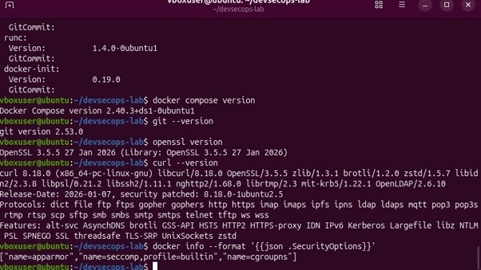

# Praktikum 1 - Menetapkan Baseline Laboratorium

Praktikum ini membuat direktori kerja tunggal
dan merekam versi komponen.

## 1. Hasil Praktikum



## 2. Penjelasan Command

### 1. Membuat direktori kerja

```bash
mkdir -p ~/devsecops-lab/{app,policy,reports,sbom,keys}
```

Digunakan untuk membuat direktori devsecops-lab
beserta beberapa subdirektori yang diperlukan.

### 2. Berpindah direktori
```bash
cd ~/devsecops-lab
```
Digunakan untuk berpindah ke direktori
devsecops-lab sebagai lokasi kerja praktikum.

### 3. Mengecek versi Docker
```bash
docker version
```
Digunakan untuk mengecek versi Docker yang terpasang serta memastikan Docker Engine dapat digunakan

### 4. Mengecek versi Docker Compose
```bash
docker compose version
```
Digunakan untuk mengecek versi Docker Compose yang terpasang dan memastikan Compose dapat digunakan.

### 5. Mengecek versi Git
```bash
git --version
```
Digunakan untuk mengecek versi Git yang terpasang pada sistem. 

### 6. Mengecek versi OpenSSL
```bash
openssl version
```
Digunakan untuk mengecek versi OpenSSL yang tersedia untuk mendukung kebutuhan keamanan dan kriptografi.

### 7. Mengecek versi cURL
```bash
curl --version
```
Digunakan untuk mengecek versi cURL yang digunakan untuk melakukan komunikasi atau permintaan melalui jaringan. 

### 8. Menampilkan fitur keamanan
```bash
docker info --format '{{json .SecurityOptions}}'
```
Digunakan untuk menampilkan fitur keamanan yang diterapkan pada Docker, seperti AppArmor, seccomp, dan cgroupns. 

## 9. Command Tambahan

```bash
sudo apt update
sudo apt install docker.io docker-compose-plugin -y
sudo systemctl enable --now docker
```

## 4. Analisis Hasil Praktikum

Berdasarkan hasil praktikum, konfigurasi awal lingkungan DevOps pada Ubuntu di VirtualBox telah berhasil dilakukan. Docker Compose berhasil terpasang dengan versi 2.40.3, sedangkan Git yang digunakan adalah versi 2.53.0. Selain itu, OpenSSL berhasil berjalan pada versi 3.5.5 dan cURL pada versi 8.18.0. 
Hasil pemeriksaan keamanan Docker menggunakan docker info menunjukkan adanya tiga security options, yaitu AppArmor, seccomp, dan cgroup namespace (cgroupns). Hal ini menunjukkan bahwa Docker telah berjalan dengan mekanisme isolasi dan pembatasan keamanan yang tersedia pada sistem Ubuntu. 
Dengan demikian, lingkungan yang digunakan untuk praktikum DevOps telah berhasil dikonfigurasi dan seluruh tools utama yang diperlukan, yaitu Docker, Docker Compose, Git, OpenSSL, dan cURL, dapat digunakan. Environment ini selanjutnya dapat digunakan untuk menjalankan tahapan praktikum DevOps berikutnya. 


## 5. Evaluasi

### 1. Mengapa DevSecOps tidak dapat direduksi menjadi penambahan scanner pada pipeline? 
DevSecOps bukan hanya menambahkan scanner keamanan, tetapi mengintegrasikan keamanan ke seluruh proses pengembangan, mulai dari perencanaan, coding, testing, deployment, hingga monitoring. Scanner hanya membantu menemukan kerentanan, sedangkan DevSecOps juga mencakup pengelolaan risiko, perbaikan temuan, kolaborasi tim, dan penerapan kontrol keamanan.  
### 2. Evidence apa yang membedakan klaim kontrol dari kontrol yang benar-benar terverifikasi? 
Kontrol yang terverifikasi harus didukung oleh bukti yang dapat diperiksa dan diulang, seperti hasil scan, log, konfigurasi, screenshot, laporan pengujian, atau output command. Jadi, pernyataan seperti “Docker sudah aman” hanya merupakan klaim jika tidak disertai bukti yang menunjukkan konfigurasi dan hasil pengujiannya. 
### 3. Bagaimana shared responsibility memengaruhi ownership risiko dan tindak lanjut temuan? 
Shared responsibility berarti tanggung jawab keamanan dibagi berdasarkan peran masing-masing pihak. Setiap temuan harus memiliki owner yang jelas untuk melakukan analisis, perbaikan, verifikasi, dan monitoring. Dengan demikian, temuan keamanan tidak hanya menjadi tanggung jawab tim security, tetapi juga developer, DevOps, maupun penyedia layanan sesuai lingkup tanggung jawabnya. 

DevSecOps mengintegrasikan keamanan ke seluruh
proses pengembangan perangkat lunak.
