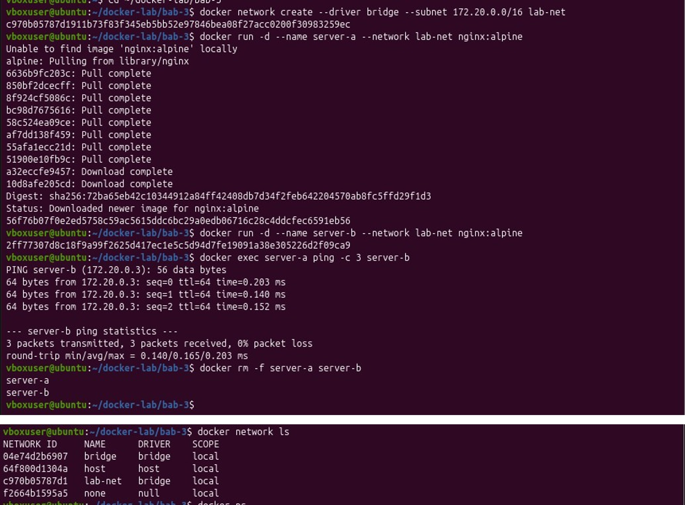
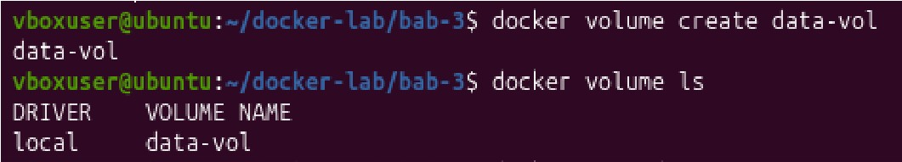
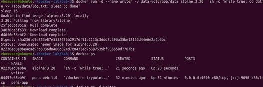
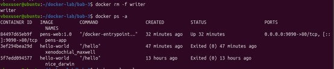
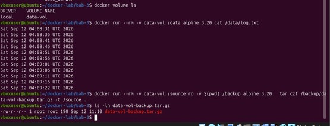
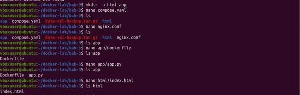
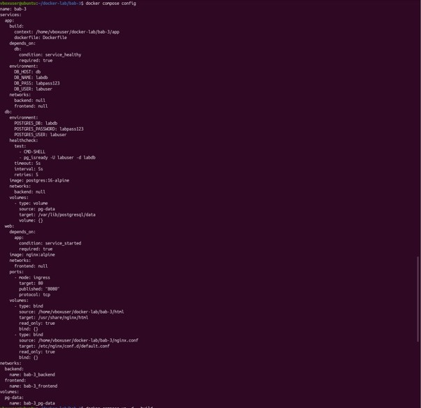
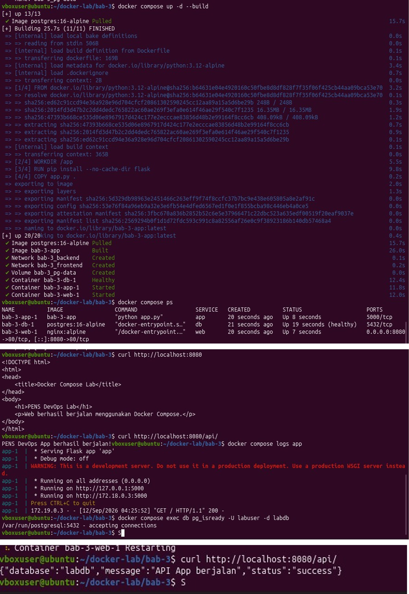

# Bab 3 — Docker Network, Volume, Bind Mount, tmpfs, dan Compose 
### 1. Struktur direktori umum Bab 3 

### 2. User-defined bridge network 

### 3. Volume backup dan restore 
1.	Membuat volume 

2.	Menjalankan container writer 

3.	Menghapus container writer  

4.	Membaca dan Membackup dari Volume 

### 4. Compose multi-container Nginx-Flask-PostgreSQL 

## Verifikasi dan Skenario Pengujian 
- [x] Container di user-defined bridge dapat saling resolve menggunakan nama. 
- [x] Data di named volume tetap ada setelah container dihapus. 
- [ ] Bind mount menunjukkan perubahan file host tanpa rebuild image. 
- [ ] tmpfs kehilangan data setelah container restart. 
- [x] Compose stack web-app-db berjalan dan API health menampilkan koneksi database. 
Pengujian bind mount dan tmpfs tidak dilakukan karena kedua skenario tersebut tidak menjadi fokus pengujian yang dilakukan pada praktikum ini. Pengujian difokuskan pada network, persistence menggunakan named volume, serta implementasi Docker Compose web-app-db dan koneksi database. 
 
## Evaluasi dan Latihan Mandiri 
### 1.	Mengapa user-defined bridge lebih baik daripada default bridge untuk multi-container app? 
User-defined bridge lebih baik karena menyediakan DNS internal, sehingga container dapat saling berkomunikasi menggunakan nama container atau service. Selain itu, network dapat diatur lebih terstruktur dan container yang tidak berada dalam network tersebut tidak dapat berkomunikasi secara langsung. 
### 2.	Apa risiko bind mount terhadap keamanan host? 
Bind mount memiliki risiko keamanan karena container dapat mengakses file atau direktori pada host yang di-mount. Jika container memiliki akses tulis, aplikasi di dalam container berpotensi mengubah atau menghapus file host. Oleh karena itu, bind mount sebaiknya hanya digunakan pada direktori yang memang diperlukan dan menggunakan mode read-only jika memungkinkan. 
### 3.	Apa perbedaan docker compose down dan docker compose down -v? 
docker compose down menghentikan dan menghapus container serta network yang dibuat oleh Compose, tetapi named volume tetap dipertahankan. Sedangkan docker compose down -v juga menghapus named volume, sehingga data yang tersimpan di dalam volume dapat ikut hilang. 
### 4.	Kapan depends_on dengan healthcheck lebih tepat daripada depends_on biasa? 
depends_on dengan healthcheck lebih tepat ketika suatu service benar-benar membutuhkan service lain yang sudah siap digunakan, misalnya aplikasi membutuhkan database yang sudah siap menerima koneksi. Dengan healthcheck, Compose dapat menunggu database berstatus healthy sebelum menjalankan aplikasi. 
### 5.	Bagaimana strategi backup volume untuk database produksi? 
Backup database produksi sebaiknya dilakukan secara terjadwal dan otomatis, menggunakan metode backup database seperti pg_dump untuk PostgreSQL. Backup sebaiknya disimpan di lokasi terpisah dari server utama, memiliki beberapa versi/cadangan, serta dilakukan uji restore secara berkala untuk memastikan backup benar-benar dapat digunakan saat terjadi kegagalan. 
 
## Analisis Wajib 
### 1. Masalah yang muncul dan cara mendiagnosisnya 
Salah satu masalah yang muncul adalah API /api/ awalnya menampilkan halaman utama aplikasi, bukan respons API. Masalah didiagnosis dengan memeriksa konfigurasi nginx.conf dan menemukan penggunaan proxy_pass http://app:5000/; yang menyebabkan path /api/ diteruskan menjadi /. Setelah tanda / terakhir pada proxy_pass dihapus dan container web direstart, API dapat menampilkan respons yang benar beserta informasi database. 
### 2.	Risiko keamanan atau operasional yang relevan 
Risiko yang perlu diperhatikan adalah penggunaan bind mount dan akses Docker. Bind mount dapat memberikan container akses terhadap file pada host sehingga apabila container berhasil disalahgunakan, file host yang di-mount dapat ikut diubah atau dihapus. Selain itu, pengguna yang memiliki akses ke Docker dapat memiliki hak yang sangat tinggi terhadap sistem host. 
### 3.	Rekomendasi perbaikan untuk production-like environment 
Jika lab diterapkan pada lingkungan production-like, sebaiknya menggunakan image dengan versi yang dipastikan atau di-pin, membatasi akses Docker, menggunakan container dengan user non-root, membatasi port yang terbuka, menggunakan bind mount read-only jika memungkinkan, serta menerapkan backup database secara berkala dan menguji proses restore untuk memastikan data dapat dipulihkan. 
 
 
