# Bab 4 - Web Service Container: Apache, Nginx, Reverse Proxy, dan TLS

### 1. Membuat direktori
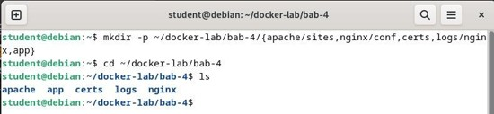

Analisis: Pembuatan direktori tersebut bertujuan untuk memisahkan file konfigurasi, volume bind mount, dan laporan agar lebih rapi serta tidak tercampur dengan praktikum di bab lainnya. Di dalam direktori utamanya, terdapat folder spesifik seperti apache/sites untuk menyimpan file web statis dan nginx/conf sebagai tempat pengaturan konfigurasi reverse proxy. Anda juga membuat folder certs untuk menyimpan sertifikat TLS, serta logs/nginx agar catatan aktivitas dan error server bisa dibaca langsung dari komputer host. Terakhir, folder app disiapkan untuk menaruh kode sumber aplikasi backend, di mana pengelompokan semua folder ini akan sangat memudahkan proses pembersihan sistem setelah praktikum selesai.

### 2. Sertifikat TLS Laboratorium
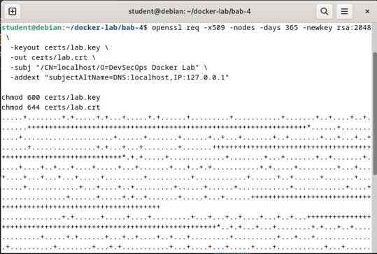

Analisis: Perintah pada gambar tersebut dieksekusi untuk membuat sertifikat TLS self-signed menggunakan OpenSSL guna keperluan simulasi koneksi HTTPS di lingkungan praktikum. Proses ini menghasilkan kunci privat (lab.key) dan sertifikat publik (lab.crt) yang berlaku selama satu tahun, lalu menyimpannya ke dalam direktori certs. Setelah berkas terbentuk, perintah chmod digunakan untuk membatasi hak akses secara ketat, terutama pada kunci privat agar tidak dibaca oleh pengguna yang tidak berhak. Sertifikat buatan sendiri ini selanjutnya akan dipasang pada layanan reverse proxy Nginx untuk menangani proses terminasi enkripsi TLS sebelum meneruskan koneksi ke backend.

### 3. File compose.yaml
#### nano compose.yaml
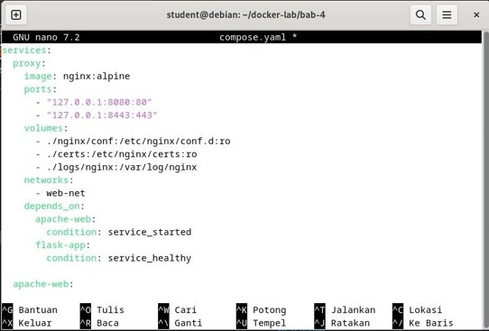

Analisis: Gambar tersebut menampilkan penyuntingan berkas compose.yaml menggunakan editor teks nano, yang berfungsi untuk mendefinisikan arsitektur web stack dengan Nginx sebagai reverse proxy. Konfigurasi ini mengatur agar container Nginx mempublikasikan port 8080 dan 8443 secara spesifik ke localhost (127.0.0.1), memasang direktori konfigurasi dan sertifikat secara read-only, serta menetapkan urutan startup (melalui depends_on) agar layanan Nginx baru dimulai setelah layanan apache-web berjalan dan flask-app dalam kondisi sehat (healthy).

### 4. File nginx/conf/default.conf
#### nano nginx/conf/default.conf
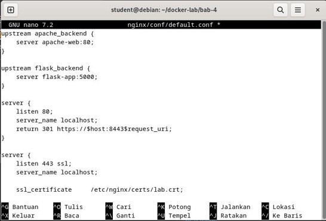

Analisis: Konfigurasi nginx/conf/default.conf tersebut mengatur Nginx untuk berperan sebagai reverse proxy dan menangani terminasi TLS. Pada bagian awal, terdapat dua blok upstream yang didefinisikan untuk menghubungkan Nginx dengan layanan backend, yaitu apache-web pada port 80 dan flask-app pada port 5000. Selanjutnya, blok server pertama diatur untuk menerima lalu lintas HTTP tak terenkripsi di port 80 dan secara otomatis mengalihkannya (redirect 301) ke koneksi HTTPS yang aman pada port 8443. Pada bagian akhir yang terlihat, blok server kedua mendengarkan lalu lintas pada port 443 dan memuat sertifikat publik (lab.crt) untuk mengenkripsi koneksi jaringan.

### 5. File apache/sites/index.html
#### nano apache/sites/index.html
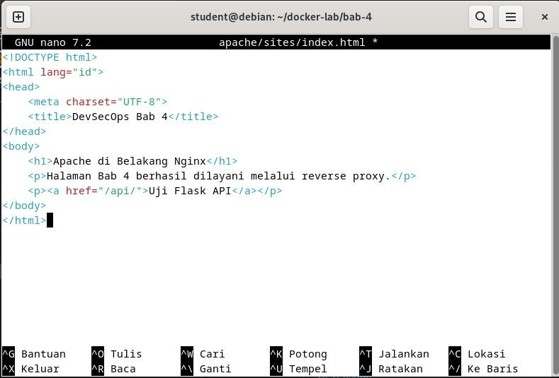

Analisis: Gambar tersebut menunjukkan proses pembuatan berkas index.html menggunakan teks editor nano di dalam direktori apache/sites. Berkas HTML sederhana ini nantinya akan disajikan oleh web server Apache yang berada di belakang Nginx sebagai reverse proxy. Di dalamnya memuat elemen judul dasar, pesan keberhasilan ("Halaman Bab 4 berhasil dilayani melalui reverse proxy."), serta sebuah tautan hiperteks yang mengarah ke endpoint /api/ untuk menguji backend aplikasi Flask. Pembuatan file statis ini merupakan langkah penting untuk memastikan bahwa jalur routing dari proxy ke backend service berfungsi dengan benar dalam lingkungan praktikum tersebut.

### 6. File app/requirements.txt
##### nano app/requirements.txt
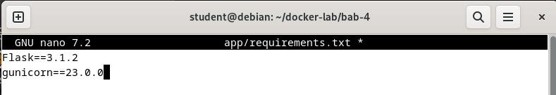

Analisis: Gambar tersebut menampilkan proses pembuatan berkas requirements.txt di dalam subdirektori app menggunakan teks editor nano. Berkas ini berfungsi untuk mendefinisikan daftar pustaka (dependensi) Python yang dibutuhkan untuk menjalankan layanan backend aplikasi. Di dalamnya, telah ditetapkan versi pustaka yang spesifik secara ketat, yaitu kerangka kerja Flask versi 3.1.2 dan server web WSGI gunicorn versi 23.0.0. Daftar dependensi ini nantinya akan dibaca dan diinstal secara otomatis oleh Docker saat mengeksekusi instruksi build untuk container flask-app, guna memastikan lingkungan aplikasi dibangun dengan pustaka yang tepat.

### 7. File app/app.py
#### nano app.py
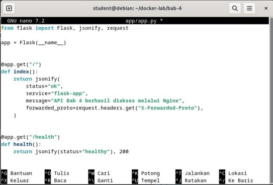

Analisis: Gambar tersebut memperlihatkan pembuatan kode sumber aplikasi backend menggunakan framework Flask yang disimpan di dalam berkas app/app.py. Skrip sederhana ini mendefinisikan rute utama (/) untuk memvalidasi keberhasilan akses melalui reverse proxy dengan merender nilai header jaringan, serta menyediakan rute /health yang berfungsi sebagai titik pengecekan kesehatan (health check) agar Docker Compose mengetahui bahwa layanan sudah siap.

### 8. File app/Dockerfile
#### nano app/Dockerfile
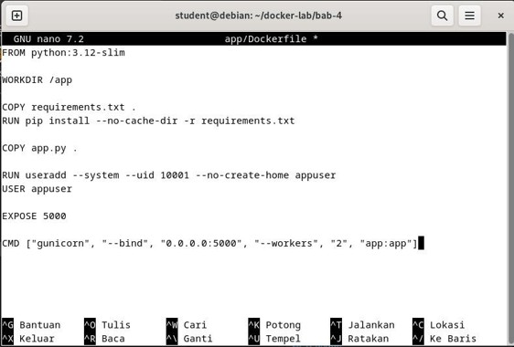

Analisis: Gambar tersebut menampilkan instruksi Dockerfile di dalam subdirektori app yang digunakan untuk membangun image layanan Flask berbasis python:3.12-slim dengan menyalin kode aplikasi dan menginstal dependensinya. Selain itu, konfigurasi ini menerapkan praktik keamanan yang baik dengan membuat dan menggunakan akun non-root (appuser) untuk menjalankan aplikasi melalui server Gunicorn pada port 5000.

### 9. Validasi
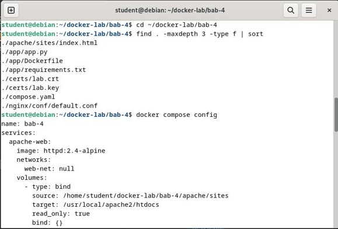
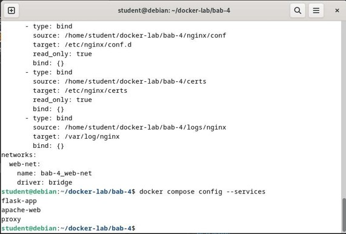

Analisis: ketiga service yang harus muncul sudah tertampil.

### 10. Build dan Menjalankan Stack
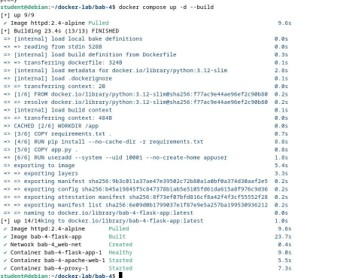
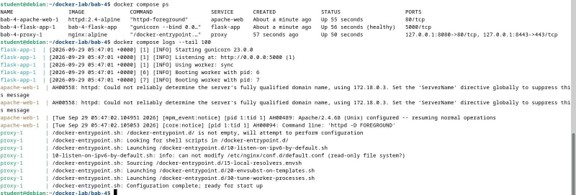

Analisis: Gambar tersebut menunjukkan proses eksekusi perintah docker compose up -d --build yang berhasil membangun image dan menjalankan seluruh layanan, terlihat dari status container apache-web, flask-app (dalam kondisi healthy), serta proxy yang aktif beroperasi dengan pemetaan portnya masing-masing. Analisis pada log terminal juga mengonfirmasi bahwa backend Flask dan server Apache berjalan normal, sementara proxy Nginx berhasil memuat skrip dari direktori read-only tanpa adanya eror kritis sehingga siap menerima trafik.

### 11. Pengujian Cepat
#### HTTP harus redirect ke HTTPS
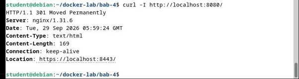

Analisis: Gambar tersebut menampilkan hasil pengujian cepat menggunakan perintah curl -I untuk memeriksa respons pada antarmuka web lokal di port HTTP 8080. Keluaran log yang menunjukkan status HTTP/1.1 301 Moved Permanently dengan target lokasi menuju https://localhost:8443/ membuktikan bahwa server Nginx telah beroperasi dengan benar dalam mengalihkan (redirect) koneksi HTTP yang tidak aman ke koneksi HTTPS yang terenkripsi.

#### Halaman Apache melalui Nginx
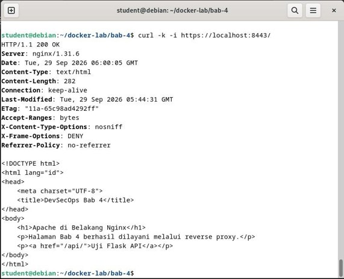

Analisis: Gambar tersebut menampilkan pengujian koneksi HTTPS ke reverse proxy Nginx menggunakan perintah curl -k -i pada port 8443. Parameter -k pada perintah tersebut sengaja digunakan untuk melewati proses validasi keamanan sertifikat pada sisi klien, mengingat sertifikat TLS yang digunakan merupakan buatan sendiri (self-signed). Hasil eksekusi yang mengembalikan kode status HTTP/1.1 200 OK mengonfirmasi bahwa koneksi aman telah berhasil diinisiasi oleh Nginx. Kemunculan kode HTML pada akhir keluaran membuktikan secara pasti bahwa proxy sukses meneruskan permintaan tersebut dan mengambil halaman web statis dari layanan backend Apache di belakangnya. 

#### Flask API melalui Nginx
#### Health endpoint Flask
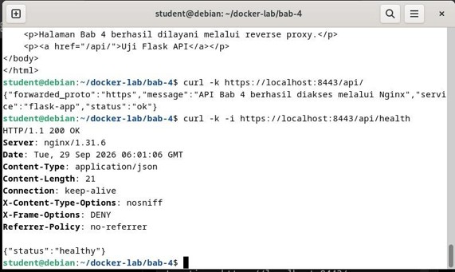

Analisis: Gambar tersebut mendemonstrasikan pengujian akses ke aplikasi backend Flask melalui Nginx sebagai reverse proxy dengan memanggil perintah curl -k secara aman pada porta 8443. Eksekusi pertama pada endpoint /api/ berhasil mengembalikan respons berformat JSON yang memastikan bahwa proksi telah meneruskan permintaan secara tepat dan berhasil mempertahankan informasi protokol melalui parameter "forwarded_proto":"https". Selanjutnya, pengujian kedua difokuskan pada rute pemantauan /api/health dengan menambahkan parameter -i untuk turut menampilkan header HTTP balasan. Keluaran berupa kode status HTTP/1.1 200 OK dengan pesan {"status":"healthy"} mengonfirmasi bahwa layanan API beroperasi normal dan pengecekan kesehatannya dapat dijangkau dengan baik melalui jalur Nginx.

#### Informasi TLS
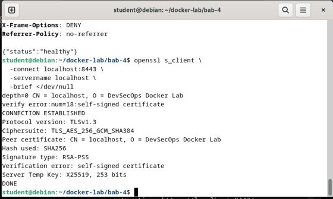

Analisis: Gambar tersebut menampilkan pengujian konfigurasi keamanan TLS menggunakan utilitas openssl s_client untuk memeriksa detail enkripsi pada reverse proxy Nginx di port 8443. Hasil eksekusi pada terminal mengonfirmasi bahwa koneksi aman berhasil dibangun (CONNECTION ESTABLISHED) dengan menggunakan standar enkripsi modern, yakni protokol TLSv1.3 beserta ciphersuite yang tangguh. Log tersebut juga memvalidasi identitas sertifikat jaringan (Peer certificate), dengan Common Name (CN) localhost dan organisasi DevSecOps Docker Lab sesuai yang telah dibuat sebelumnya. Meskipun lalu lintas data berhasil dienkripsi, peringatan verify error terkait self-signed certificate secara wajar muncul karena sertifikat simulasi laboratorium ini tidak diterbitkan oleh otoritas sertifikat publik yang terpercaya.

### 12. Pemeriksaan Isolasi
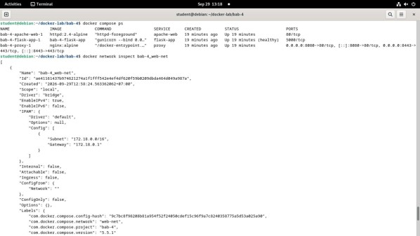
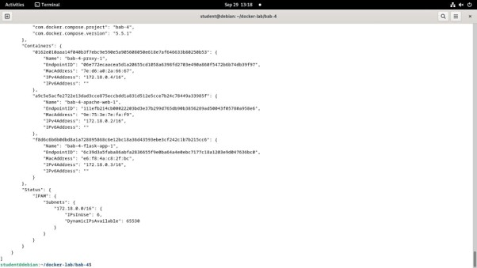
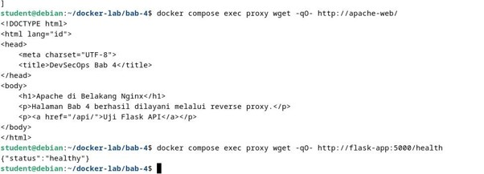

Analisis: Serangkaian gambar tersebut mengilustrasikan proses pemeriksaan isolasi jaringan dan interkoneksi antar-container pada lingkungan Docker. Eksekusi docker compose ps mengonfirmasi bahwa seluruh layanan beroperasi secara aktif, sementara perintah docker network inspect bab-4_web-net membuktikan bahwa container proxy, apache-web, dan flask-app tergabung dalam satu jejaring privat yang sama (berada pada subnet 172.18.0.0/16). Berada di jaringan yang sama memungkinkan container Nginx (proxy) untuk berkomunikasi langsung dengan layanan backend menggunakan nama host (resolusi DNS internal Docker), yang dibuktikan melalui keberhasilan eksekusi wget dari dalam container proxy untuk mengambil halaman HTML dari apache-web dan status health dari flask-app:5000. Hal ini merepresentasikan implementasi praktik keamanan di mana backend service terisolasi dan hanya dapat diakses melalui reverse proxy.

### 13. Log
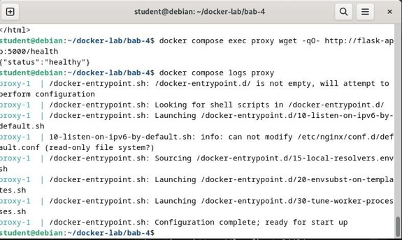
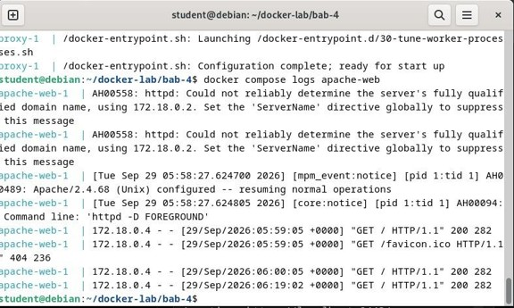
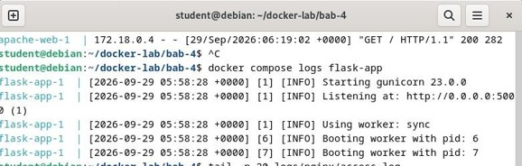
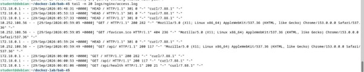
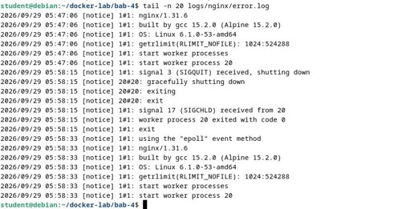

Analisis:Rangkaian log tersebut secara komprehensif membuktikan bahwa seluruh komponen web stack beroperasi normal dan saling terintegrasi dengan baik. Log Nginx dan Apache mengonfirmasi inisialisasi awal yang sukses serta kemampuan menerima trafik melalui jaringan internal container, sementara log Flask menunjukkan bahwa server Gunicorn telah aktif dan mendengarkan permintaan di port 5000. Selain itu, inspeksi pada access.log dan error.log yang tersimpan di mesin host memperlihatkan detail interaksi klien secara langsung, seperti redirect HTTPS (301) dan balasan sukses (200), tanpa adanya indikasi kegagalan sistem yang fatal. Hal ini memvalidasi bahwa sistem pemantauan audit telah berjalan sesuai dengan desain keamanan pada praktikum tersebut.

## Hasil di Web
 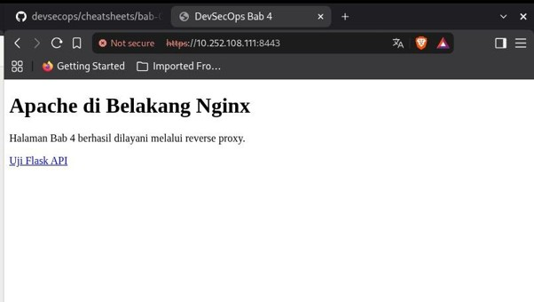
 
Analisis: Gambar tersebut menampilkan tampilan halaman utama aplikasi web saat diakses melalui peramban web (browser) menggunakan protokol HTTPS pada porta 8443. Kehadiran peringatan "Not secure" pada address bar mengonfirmasi kembali penggunaan sertifikat TLS self-signed yang belum dikenali oleh peramban. Terlepas dari peringatan tersebut, halaman statis HTML bertajuk "Apache di Belakang Nginx" beserta tautan "Uji Flask API" sukses dirender, menjadi bukti konkret bahwa Nginx telah secara sempurna berfungsi sebagai reverse proxy dalam meneruskan permintaan HTTP dari klien menuju layanan web Apache di belakangnya.

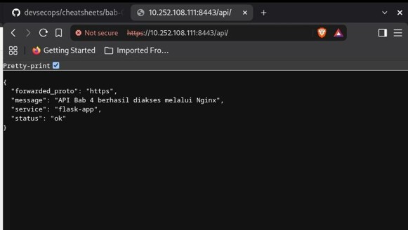

Analisis: Gambar tersebut menampilkan tampilan halaman utama aplikasi web saat diakses melalui peramban web (browser) menggunakan protokol HTTPS pada porta 8443. Kehadiran peringatan "Not secure" pada address bar mengonfirmasi kembali penggunaan sertifikat TLS self-signed yang belum dikenali oleh peramban. Terlepas dari peringatan tersebut, halaman statis HTML bertajuk "Apache di Belakang Nginx" beserta tautan "Uji Flask API" sukses dirender, menjadi bukti konkret bahwa Nginx telah secara sempurna berfungsi sebagai reverse proxy dalam meneruskan permintaan HTTP dari klien menuju layanan web Apache di belakangnya.

## Checklist PASS
- [x] docker compose config tidak menghasilkan galat.
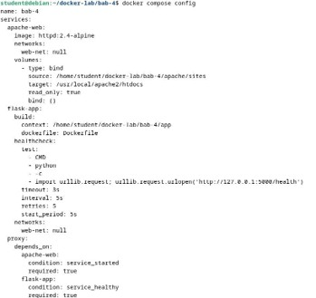

Hasil: PASS ✅
Perintah docker compose config berhasil dijalankan dan tidak menghasilkan error. Hal ini menunjukkan bahwa file Docker Compose memiliki struktur dan sintaks konfigurasi yang valid. Konfigurasi berhasil mengenali beberapa komponen utama, yaitu:
- Apache Web menggunakan image httpd:2.4-alpine.
- Flask App dibangun menggunakan Dockerfile.
- Healthcheck Flask telah dikonfigurasi untuk memastikan aplikasi dalam kondisi sehat.
- Network web-net digunakan untuk menghubungkan antar-service.
- depends_on pada proxy telah mengatur urutan startup berdasarkan status service.

- [x] flask-app berstatus healthy.
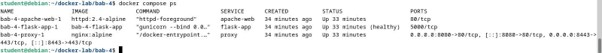

PASS, karena ketiga container (apache-web, flask-app, dan proxy) berhasil berjalan. Flask juga berstatus healthy, yang menandakan aplikasi telah siap menerima request. Selain itu, port 8080 dan 8443 telah berhasil dipetakan dari host ke container proxy.

- [x] HTTP port 8080 menghasilkan redirect 301.
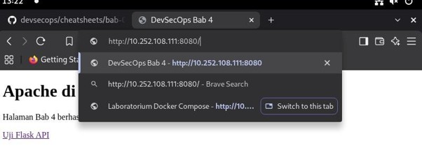

Hasil: PASS 
HTTP pada port 8080 menghasilkan redirect 301.
Berdasarkan pengujian melalui browser, ketika mengakses HTTP pada port 8080, server memberikan HTTP status 301 (Moved Permanently). Hal ini menunjukkan bahwa konfigurasi redirect dari HTTP ke HTTPS berhasil diterapkan.
Gambar dari View Page Source juga menunjukkan bahwa halaman dapat ditampilkan melalui browser, sehingga request berhasil diproses oleh konfigurasi web server/proxy.

- [x] HTTPS port 8443 menampilkan halaman Apache.
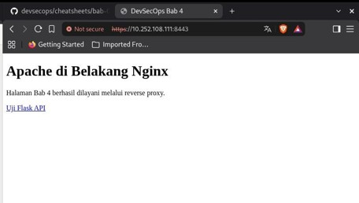
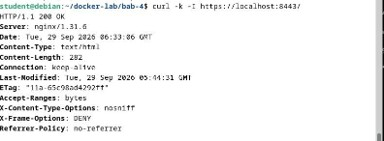

PASS, karena akses HTTPS melalui port 8443 berhasil menampilkan halaman Apache di browser dan curl menghasilkan HTTP/1.1 200 OK. Hal ini membuktikan bahwa konfigurasi HTTPS, Nginx sebagai proxy, dan Apache sebagai web server telah berjalan dengan baik.
 
- [x] /api/ menghasilkan JSON Flask.
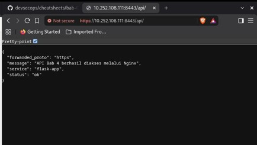

Hasil tersebut menunjukkan bahwa:
- Request HTTPS berhasil diterima oleh Nginx.
- Nginx berhasil meneruskan request /api/ ke Flask App.
- Flask berhasil memproses request dan mengembalikan response JSON.
- "status": "ok" menunjukkan API berhasil diakses.
- "service": "flask-app" memastikan response berasal dari service Flask.
- "forwarded_proto": "https" menunjukkan bahwa request diteruskan dengan informasi bahwa protokol awal yang digunakan adalah HTTPS.

- [ ] TLS 1.2 atau TLS 1.3 berhasil dinegosiasikan.
- [ ] Apache dan Flask tidak memiliki published port.
- [x] Request tercatat pada access log Nginx.
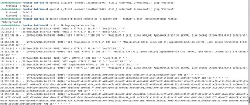

PASS, karena TLS 1.2 dan TLS 1.3 berhasil dinegosiasikan, port Apache dan Flask tidak dipublish langsung ke host, serta request berhasil tercatat pada access log Nginx. Hal ini menunjukkan bahwa arsitektur reverse proxy dan konfigurasi keamanan jaringan Docker telah berjalan sesuai rancangan. 

## Evaluasi dan Latihan Mandiri
### 1. Mengapa reverse proxy tidak seharusnya menjalankan semua logic aplikasi?
Reverse proxy tidak boleh menjalankan seluruh logic aplikasi karena tugas utamanya adalah mengelola lalu lintas jaringan seperti routing, load balancing, dan caching; jika dipaksa memproses query database atau transaksi yang berat, CPU dan RAM proxy akan terkuras sehingga menciptakan bottleneck bagi seluruh sistem serta merusak prinsip pemisahan tugas (separation of concerns).
### 2. Apa perbedaan TLS termination dan end-to-end TLS?
Perbedaan utamanya terletak pada titik dekripsi data, di mana pada TLS termination proses dekripsi HTTPS dilakukan di reverse proxy dan komunikasi ke backend diteruskan sebagai HTTP biasa tanpa enkripsi, sedangkan pada end-to-end TLS data tetap terenkripsi penuh dari browser client melewati proxy hingga baru didekripsi di dalam backend server demi keamanan zero trust.
### 3. Bagaimana cara mengisolasi backend agar tidak langsung diakses dari host?
Cara mengisolasi backend agar tidak bisa diakses langsung dari host adalah dengan memasukkannya ke dalam private custom network (misalnya Docker network terpisah) dan tidak memublikasikan portnya ke IP host (menghapus bagian ports pada docker-compose dan hanya mengandalkan komunikasi antar-kontainer), atau membatasi port backend menggunakan firewall agar hanya menerima akses dari IP milik reverse proxy.
### 4. Apa konsekuensi menyimpan private key TLS di bind mount?
Menyimpan private key TLS melalui bind mount sangat beresiko karena jika kontainer berhasil diretas, penyerang bisa memanfaatkan jalur bind mount untuk mengakses filesystem host, belum lagi masalah izin akses (permission) yang sering dikonfigurasi terlalu bebas (chmod 777) sehingga private key tersebut makin rentan tercuri atau terekspos secara tidak sengaja.
### 5. Bandingkan log Nginx dan log Apache dari sisi format dan kegunaan debugging.
Dari sisi format dan debugging, log Nginx cenderung lebih ringkas, konsisten, dan sangat efektif untuk mendiagnosis masalah performa jaringan serta latency upstream, sementara log Apache jauh lebih verbose dan menyertakan rincian modul internal sehingga sangat berguna untuk melacak crash pada level fungsi atau script handler aplikasi.

