# Bab 5 - PostgreSQL, pgAdmin, Volume, Backup, dan Restore

### 1. Menyiapkan Direktori Bab 5
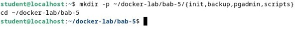

Proses awal untuk membuat struktur folder laboratorium (init, backup, pgadmin, scripts) menggunakan perintah mkdir -p. Langkah ini memastikan seluruh komponen proyek tersusun rapi dalam satu direktori induk (bab-5) sebelum file konfigurasi dan script mulai dibuat.

### 2. File .env.example
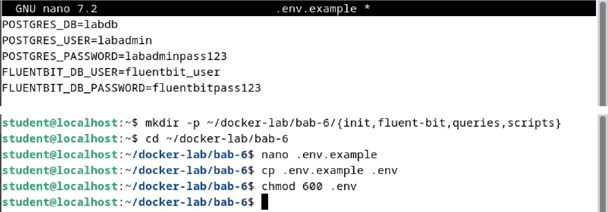

Template variabel lingkungan yang berisi credential sintetis untuk database dan pgAdmin (seperti nama user, password, dan database). File ini disalin menjadi .env aktif dengan permission ketat (chmod 600) agar Compose dapat membaca nilainya tanpa membocorkan rahasia ke dalam repositori Git.

### 3. File .gitignore
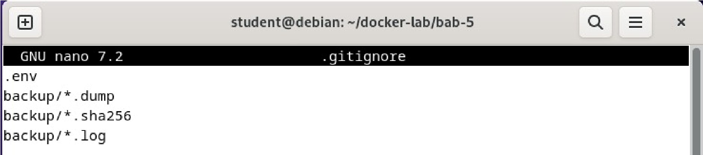

File konfigurasi Git yang berfungsi mencegah file kredensial sensitif seperti .env serta file hasil backup (.dump, .sha256, dan .log) agar tidak terekam atau terunggah secara tidak sengaja ke repositori. Dengan mengisolasi file-file tersebut, risiko kebocoran data penting atau credential laboratorium ke publik dapat dihindari.

### 4. File compose.yaml
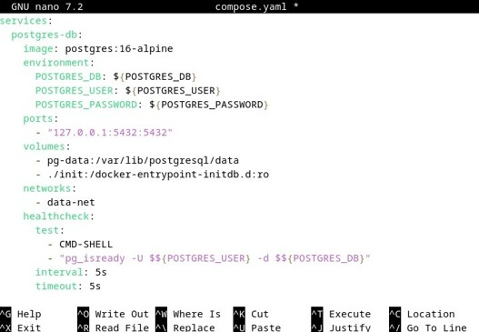

File orkestrasi Docker yang mendefinisikan service PostgreSQL dan pgAdmin, pembuatan volume terisolasi, bridge network, serta healthcheck. File ini mengatur agar pgAdmin baru berjalan setelah PostgreSQL siap (healthy), dan membatasi akses port hanya ke loopback lokal untuk keamanan.

### 5. File init/01-schema.sql
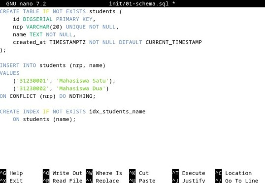

Script SQL inisialisasi yang otomatis dieksekusi oleh PostgreSQL saat kontainer pertama kali dijalankan pada volume yang masih kosong. File ini berfungsi membuat struktur tabel students, menambahkan indeks, serta memasukkan data awal (seed data).

### 6. File pgadmin/servers.json
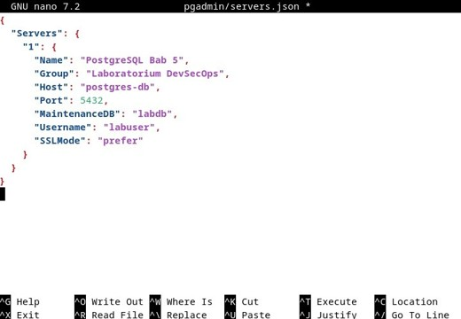

File konfigurasi otomatis untuk merregistrasi server PostgreSQL ke dalam dashboard pgAdmin secara otomatis. File ini menggunakan hostname postgres-db (nama service Compose) agar pgAdmin dapat terhubung langsung melalui jaringan internal Docker.

### 7. File scripts/backup.sh
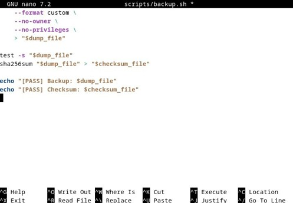

Script otomatisasi yang menjalankan perintah pg_dump dari dalam kontainer PostgreSQL menggunakan docker compose exec. Script ini menghasilkan file dump berformat kustom berstempel waktu di folder backup/ beserta pembuatan checksum SHA256 untuk memastikan integritas file backup.

### 8. File scripts/restore-test.sh
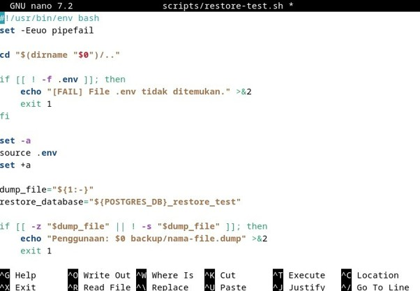

Script pengujian untuk memverifikasi file backup dengan cara memulihkannya menggunakan pg_restore ke database uji terpisah (labdb_restore_test). Prosedur ini diawali dengan validasi checksum SHA256 dan diakhiri dengan verifikasi jumlah data tanpa mengganggu atau menimpa database utama.

### 9. Permission dan Validasi File
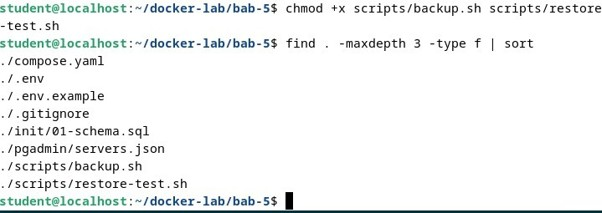

Langkah memberikan hak akses eksekusi (chmod +x) pada script backup/restore serta memeriksa validitas sintaks file Compose. Pengujian dilakukan melalui perintah docker compose config untuk memastikan tidak ada kesalahan format YAML atau variabel lingkungan sebelum stack dijalankan.

### 10. Menjalankan Stack
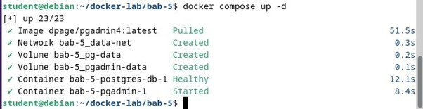

Proses menyalakan seluruh layanan di latar belakang menggunakan docker compose up -d. Pada tahap ini, status kontainer dan log dipantau hingga PostgreSQL berstatus healthy, sehingga web interface pgAdmin di http://localhost:5050 dapat diakses dan dihubungkan ke database.

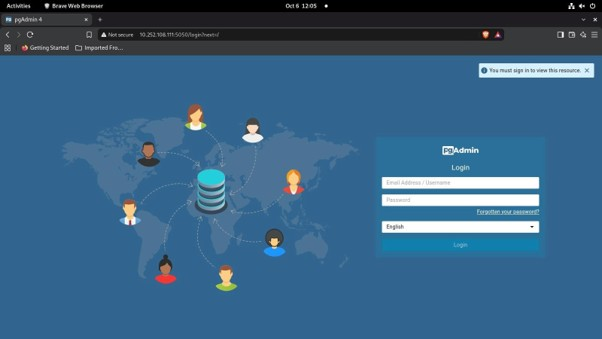

### 11. Menguji Schema dan Data Awal
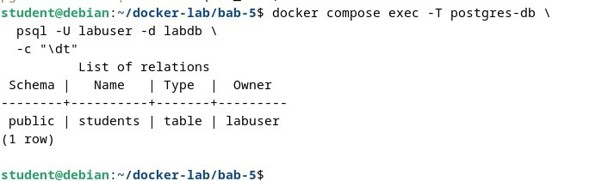

Pengujian awal menggunakan perintah psql dari dalam kontainer untuk memeriksa apakah skema dan data awal berhasil dibuat oleh script inisialisasi. Hasilnya diverifikasi dengan menampilkan daftar tabel dan isi record awal pada tabel students.

### 12. Menguji Persistensi Volume
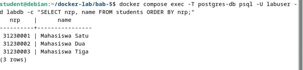

Prosedur untuk membuktikan bahwa data tidak hilang saat kontainer dimatikan atau dibuat ulang. Pengujian dilakukan dengan menambahkan data baru, menjalankan docker compose down lalu up -d kembali, dan memastikan data baru tersebut tetap tersimpan di dalam named volume PostgreSQL.

### 13. Backup
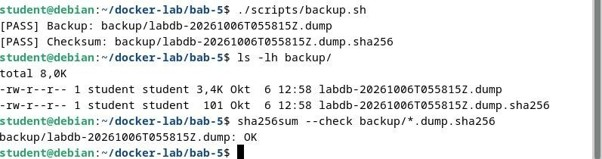

Eksekusi script backup untuk menghasilkan file .dump terbaru di folder backup host. Langkah ini tidak hanya mengecek keberadaan file, tetapi juga memverifikasi bahwa ukuran file lebih dari nol byte serta nilai checksum SHA256-nya valid.

### 14. Restore Test
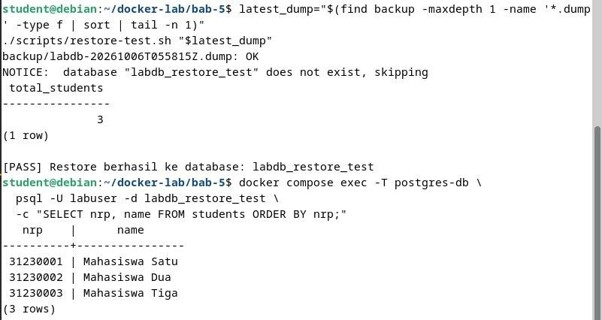

Proses pengujian pemulihan data dari file backup terbaru ke database uji. Tahap ini memastikan file backup benar-benar bisa dipakai untuk mengembalikan data dan tidak mengalami korupsi, dibuktikan dengan query jumlah record yang sesuai di database target uji.

### 15. Monitoring Dasar

Langkah pemantauan kondisi stack menggunakan perintah Docker dasar seperti pengecekan status (docker compose ps), pembacaan log (docker compose logs), uji respons database (pg_isready), serta pemantauan penggunaan kapasitas disk pada volume Docker (docker system df -v).

### 16. Cleanup Aman
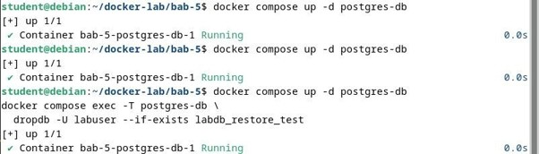

Prosedur pembersihan lingkungan laboratorium secara bertahap, mulai dari menghentikan kontainer (docker compose down), menghapus database hasil uji restore, hingga opsi menghapus volume data (docker compose down -v) jika seluruh eksperimen laboratorium sudah selesai dilakukan.

## Checklist PASS
 - [x] docker compose config tidak menghasilkan galat.
 - [x] PostgreSQL berstatus healthy.
 - [x] Tabel students dan data awal tersedia.
 - [x] pgAdmin dapat terhubung menggunakan hostname postgres-db.
 - [x] Data tetap tersedia setelah docker compose down dan up.
 - [x] Backup dump berukuran lebih dari nol.
 - [x] Checksum backup valid.
 - [x] Restore berhasil pada database labdb_restore_test.
 - [x] Jumlah dan isi record hasil restore sesuai database sumber.
 - [x] Credential dan dump tidak masuk repository Git.

## Kesimpulan
Secara keseluruhan, seluruh pengujian dinyatakan berhasil. Sistem database berbasis Docker Compose telah memenuhi aspek konfigurasi, kesehatan layanan, konektivitas, persistensi data, backup, integritas backup, restore, kesesuaian data, dan keamanan credential. Hasil ini menunjukkan bahwa implementasi database sudah dapat digunakan dengan mekanisme penyimpanan data yang persisten serta prosedur backup dan restore yang dapat diandalkan.

