# BAB 6 - APLIKASI PMB
## Latar Belakang
Dalam pengembangan dan pengoperasian aplikasi, pencatatan log merupakan bagian penting untuk mengetahui aktivitas sistem, mendeteksi kesalahan, dan membantu proses investigasi ketika terjadi insiden. Apabila setiap layanan menyimpan log secara terpisah, proses pencarian dan analisis kejadian dapat menjadi lebih sulit.
Centralized logging merupakan pendekatan yang digunakan untuk mengumpulkan log dari beberapa layanan ke dalam satu tempat penyimpanan terpusat. Dengan pendekatan ini, aktivitas dari berbagai layanan dapat ditelusuri dan dianalisis secara lebih terstruktur.
Pada praktikum Bab 6, sistem yang digunakan adalah aplikasi Penerimaan Mahasiswa Baru (PMB) yang terdiri atas beberapa layanan, yaitu registration-api, auth-service, verification-worker, Fluent Bit, database aplikasi, dan database log. Fluent Bit berfungsi mengumpulkan log dari layanan aplikasi dan meneruskannya ke database log untuk mendukung pemantauan serta investigasi insiden.

## Tujuan Praktikum
Tujuan praktikum ini adalah:
1. Memahami penerapan centralized logging pada sistem berbasis container.
2. Memahami perbedaan database transaksi aplikasi dan database penyimpanan log.
3. Mengamati pencatatan log terstruktur serta penggunaan request ID untuk menelusuri suatu transaksi.
4. Menganalisis log pada kondisi normal dan ketika terjadi kegagalan verifikasi.
5. Menguji mekanisme retry dan pemulihan pengiriman log ketika database log tidak tersedia sementara.
6. Melakukan pemeriksaan kesehatan layanan dan keamanan log.
7. Mengumpulkan bukti pengujian untuk keperluan dokumentasi praktikum.

## LINGKUNGAN DAN ARSITEKTUR SISTEM
### Lingkungan Praktikum
Praktikum dilakukan menggunakan Docker Desktop dengan lingkungan Ubuntu melalui WSL. Seluruh perintah Docker Compose dijalankan dari direktori proyek pmb-devsecops-lab.
Komponen utama yang digunakan adalah:
| **Komponen**        | **Fungsi**                                  |
| ------------------- | ------------------------------------------- |
| Docker Compose      | Mengelola dan menjalankan seluruh container |
| registration-api    | Menangani permintaan pendaftaran PMB        |
| auth-service        | Menangani layanan autentikasi               |
| verification-worker | Memproses verifikasi pendaftaran            |
| app-db              | Menyimpan data transaksi pendaftaran        |
| Fluent Bit          | Mengumpulkan dan meneruskan log layanan     |
| log-db              | Menyimpan log secara terpusat               |

Portal PMB diakses melalui http://127.0.0.1:8080/, sedangkan endpoint kesehatan Fluent Bit diperiksa melalui http://127.0.0.1:2020/api/v1/health.

### Arsitektur Sistem
Secara umum, alur kerja sistem adalah sebagai berikut:
1. Pengguna mengakses portal PMB dan mengirimkan formulir pendaftaran.
2. registration-api menerima permintaan dan menyimpan data transaksi ke app-db.
3. verification-worker menjalankan proses verifikasi.
4. Layanan aplikasi menghasilkan log selama proses berlangsung.
5. Fluent Bit mengumpulkan log dari layanan aplikasi dan meneruskannya ke log-db.
6. Log yang tersimpan dapat digunakan untuk menelusuri aktivitas sistem berdasarkan waktu, layanan, tingkat keparahan, dan request ID.
Database aplikasi dan database log mempunyai fungsi berbeda. Database aplikasi menyimpan status transaksi pendaftaran, sedangkan database log menyimpan catatan aktivitas layanan untuk kebutuhan pemantauan dan investigasi.

## PELAKSANAAN PRAKTIKUM
### 1. Persiapan direktori kerja
Praktikum dijalankan melalui terminal Ubuntu pada WSL. Direktori kerja digunakan untuk menyimpan berkas proyek PMB DevSecOps Bab 6. 


Setelah masuk ke direktori proyek, isi direktori diperiksa untuk memastikan berkas konfigurasi, skrip, dan query tersedia. 
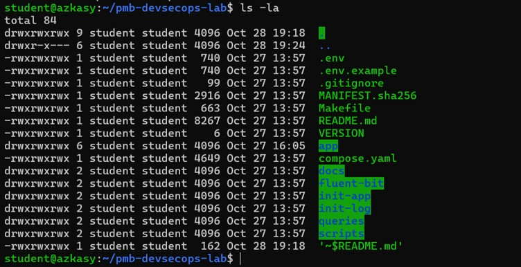

Berkas penting yang digunakan antara lain:
- compose.yaml untuk konfigurasi layanan container.
- .env untuk konfigurasi lingkungan dan kredensial.
- scripts/ untuk skrip demo, validasi, dan pengumpulan bukti.
- queries/ untuk query analisis log.
- reports/ untuk menyimpan bukti praktikum.

### 2. Menjalankan Script Setup
Setelah berada di direktori proyek, script setup dijalankan menggunakan perintah:


Script ini digunakan untuk melakukan persiapan awal lingkungan praktikum sesuai dengan implementasi yang disediakan dalam proyek.

### 3. Menjalankan Script Validasi
Setelah setup selesai, validasi awal dilakukan menggunakan perintah:
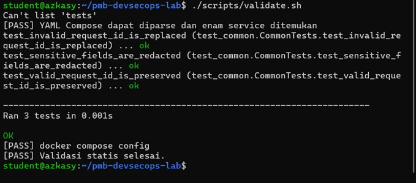

Validasi digunakan untuk memeriksa kesiapan konfigurasi dan menjalankan pengujian otomatis yang disediakan oleh proyek. Hasil pengujian yang diperoleh menunjukkan bahwa tiga pengujian berhasil, yaitu penggantian request ID yang tidak valid, penyamaran field sensitif, dan pemertahanan request ID yang valid.

### 4. Menjalankan Container
Setelah tahap validasi, seluruh layanan dijalankan menggunakan Docker Compose dengan perintah:
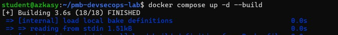
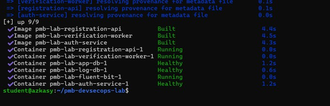

Opsi -d menjalankan container di latar belakang, sedangkan --build membangun image yang dibutuhkan sebelum layanan dijalankan.

### 5. Memeriksa Status Layanan
Setelah container dijalankan, status setiap layanan diperiksa menggunakan perintah:
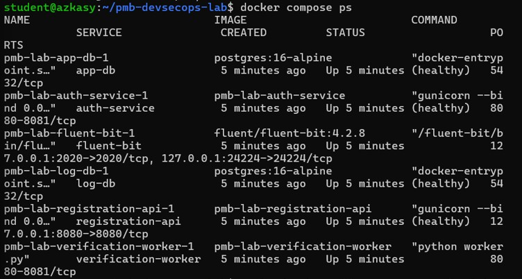

Pemeriksaan ini digunakan untuk mengetahui apakah container berjalan dan apakah layanan yang memiliki health check telah mencapai status sehat (healthy).

Selanjutnya, endpoint kesehatan portal PMB diperiksa menggunakan:
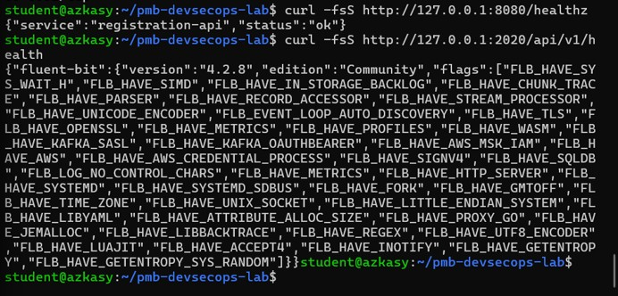

Hasil pemeriksaan menunjukkan bahwa layanan registration-api merespons dengan status ok.
Kesehatan Fluent Bit juga diperiksa menggunakan:
```bash
curl -fsS http://127.0.0.1:2020/api/v1/health
```

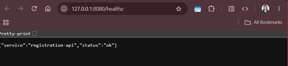

Endpoint tersebut digunakan untuk memastikan bahwa Fluent Bit dapat diakses melalui antarmuka kesehatan yang disediakan.

### 6. Membuka Portal PMB
Setelah layanan berjalan dan endpoint kesehatan berhasil diperiksa, portal PMB dibuka melalui browser pada alamat berikut:
http://127.0.0.1:8080
Portal digunakan untuk mengakses formulir pendaftaran dan melakukan pengujian transaksi pada skenario normal maupun skenario insiden.

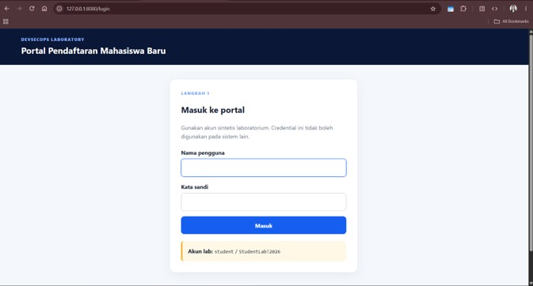

Tahap Quick start ini menjadi dasar untuk melanjutkan pengujian skenario normal, skenario insiden timeout, analisis log, serta pengujian buffering dan recovery pada tahap berikutnya.

### 7. Pengujian Skenario Normal
Pengujian skenario normal dilakukan menggunakan perintah:
./scripts/demo-normal.sh
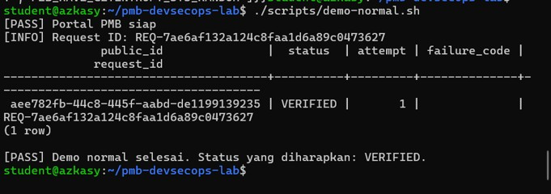

Hasil pengujian menunjukkan bahwa portal PMB siap digunakan dan transaksi pendaftaran berhasil diproses. Data hasil pengujian menunjukkan status VERIFIED, dengan nilai attempt sebesar 1 dan tanpa kode kegagalan.
Request ID yang tercatat adalah:
	REQ-7ae6af132a124c8faa1d6a89c0473627
Hasil ini menunjukkan bahwa pada skenario normal, proses pendaftaran dan verifikasi dapat berjalan sesuai dengan kondisi yang diharapkan.

### 8. Pengujian Skenario Insiden Timeout
Pengujian insiden dilakukan menggunakan perintah:
```bash
./scripts/demo-incident.sh
```
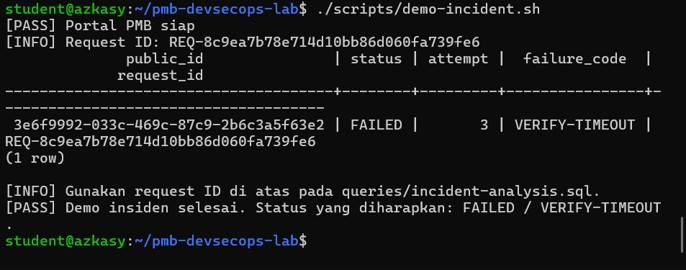

Pada skenario ini, sistem dikonfigurasi agar proses verifikasi mengalami timeout. Hasil pengujian menunjukkan bahwa transaksi berakhir dengan status FAILED, nilai attempt sebesar 3, dan kode kegagalan VERIFY-TIMEOUT.
	Request ID insiden adalah:
	REQ-8c9ea7b78e714d10bb86d060fa739fe6
Kondisi tersebut menunjukkan bahwa sistem mencatat kegagalan verifikasi setelah percobaan ulang dilakukan sesuai dengan skenario pengujian. Pesan [PASS] pada skrip menunjukkan bahwa skenario kegagalan yang direncanakan berhasil dipicu, bukan berarti transaksi berhasil diverifikasi.

### 9. Analisis Log Insiden
Analisis dilakukan dengan memeriksa data log pada database log serta data transaksi pada database aplikasi. Penelusuran menggunakan request ID memungkinkan aktivitas yang berkaitan dengan satu transaksi ditemukan dan disusun berdasarkan urutan waktu.
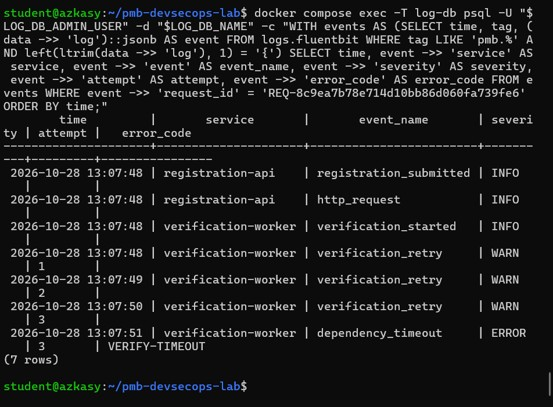

Hasil analisis terhadap request ID insiden menunjukkan urutan kejadian berikut:
| Urutan | Layanan             | Event                  | Severity |
| ------ | ------------------- | ---------------------- | -------- |
| 1      | registration-api    | registration_submitted | INFO     |
| 2      | registration-api    | http_request           | INFO     |
| 3      | verification-worker | verification_started   | INFO     |
| 4      | verification-worker | verification_retry     | WARN     |
| 5      | verification-worker | verification_retry     | WARN     |
| 6      | verification-worker | verification_retry     | WARN     |
| 7      | verification-worker | dependency_timeout     | ERROR    |

Log tersebut memperlihatkan bahwa permintaan pendaftaran diterima, proses verifikasi dimulai, kemudian terjadi tiga kejadian retry sebelum muncul error dependency_timeout dengan kode VERIFY-TIMEOUT.
Pengelompokan log berdasarkan severity juga menunjukkan adanya catatan WARN dan ERROR. Dengan demikian, log terpusat dapat digunakan untuk memahami urutan kejadian dan membantu mengidentifikasi penyebab kegagalan dalam skenario pengujian.

### 10. Pemeriksaan Keamanan Log
Pemeriksaan keamanan dilakukan dengan mencari pola teks yang berpotensi menunjukkan informasi sensitif, seperti password, authorization, bearer token, cookie, session secret, dan API key.

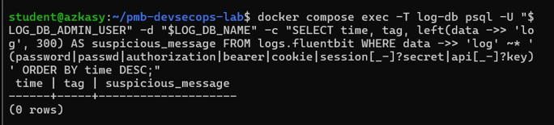

Hasil query pemeriksaan menunjukkan bahwa tidak ada baris log yang cocok dengan pola pencarian tersebut.
Hasil ini menunjukkan bahwa pemeriksaan terhadap pola secret yang ditentukan tidak menemukan indikasi kebocoran informasi sensitif. Namun, hasil kosong tidak dapat dijadikan jaminan mutlak bahwa semua jenis informasi sensitif telah terdeteksi atau tidak ada dalam log.

### 11. Pengujian Buffering dan Recovery
Pengujian buffering dan recovery bertujuan mengamati perilaku pengiriman log ketika database log tidak tersedia sementara, kemudian diaktifkan kembali.
#### 1 Mencatat Jumlah Log Awal
Sebelum database log dihentikan, dilakukan query untuk menghitung jumlah record pada tabel logs.fluentbit.
Hasil penghitungan awal adalah 726 record.

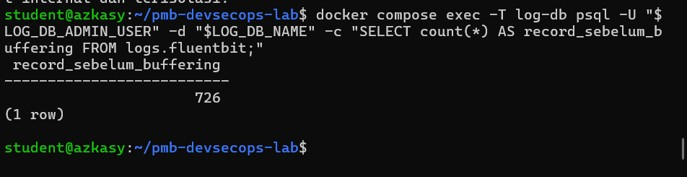

#### 2. Menghentikan Database Log
Database log dihentikan sementara menggunakan perintah:
docker compose stop log-db
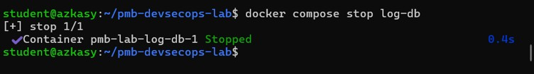

Setelah container berhenti, formulir pendaftaran baru dikirim melalui portal PMB. 
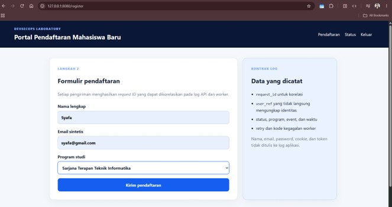

Portal memberikan respons bahwa pendaftaran diterima dan menunggu verifikasi. Data pendaftaran baru juga ditemukan pada tabel transaksi aplikasi.
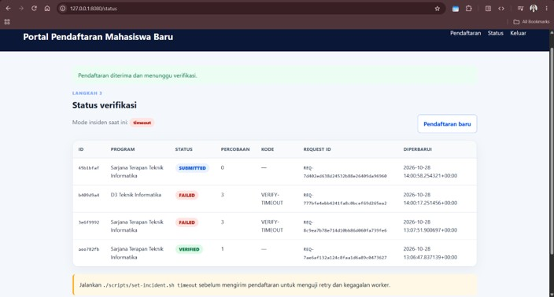

Hal tersebut menunjukkan bahwa proses penerimaan pendaftaran tetap berjalan meskipun database log sedang tidak tersedia.

#### 3. Mengamati Kegagalan Pengiriman dan Retry
Log Fluent Bit diperiksa menggunakan perintah:
```bash
docker compose logs --tail 100 fluent-bit
```
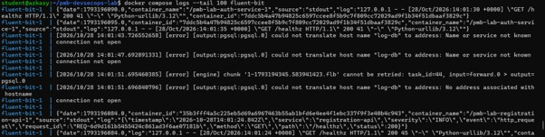

Hasilnya menunjukkan pesan kesalahan koneksi ke host log-db, disertai pesan failed to flush chunk dan retry in 10 seconds.
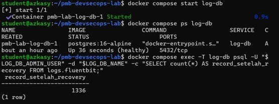

Pesan tersebut menunjukkan bahwa Fluent Bit tidak dapat mengirim kumpulan log ketika database log tidak tersedia dan menjadwalkan percobaan ulang setelah 10 detik. Dengan demikian, mekanisme retry teramati bekerja selama gangguan.

#### 4. Menyalakan Kembali Database Log
Database log diaktifkan kembali menggunakan perintah:
```bash
docker compose start log-db
```
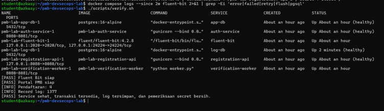

Pemeriksaan dengan docker compose ps log-db menunjukkan bahwa container kembali berjalan dengan status healthy.
Selanjutnya, jumlah record log diperiksa kembali. Hasil penghitungan menunjukkan:
| Kondisi                    | Jumlah record |
| -------------------------- | ------------- |
| Sebelum gangguan           | 726           |
| Setelah database log pulih | 1.336         |
| Saat validasi akhir        | 1.377         |

Jumlah record meningkat dari 726 menjadi 1.336, kemudian menjadi 1.377 pada pemeriksaan akhir. Selain itu, pemeriksaan log Fluent Bit selama dua menit terakhir tidak menemukan baris yang cocok dengan kata error, failed, retry, flush, atau pgsql.
Hasil tersebut mendukung bahwa sistem kembali menerima dan menyimpan log setelah database log pulih. Namun, pertambahan jumlah record tidak membuktikan bahwa seluruh record yang dihasilkan selama gangguan berhasil dikirim tanpa kehilangan atau duplikasi, karena layanan tetap menghasilkan log selama pengujian.

### 12. Validasi Akhir dan Pengumpulan Bukti
Setelah pengujian selesai, validasi dilakukan kembali menggunakan perintah:
```bash
./scripts/verify.sh
```
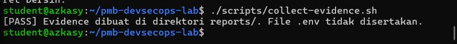

Hasil pemeriksaan akhir adalah sebagai berikut:
| Pemeriksaan          | Hasil                                        |
| -------------------- | -------------------------------------------- |
| Fluent Bit siap      | PASS                                         |
| Portal PMB siap      | PASS                                         |
| Pendaftaran tersedia | 4                                            |
| Record log tersimpan | 1.377                                        |
| Pemeriksaan secret   | Bersih berdasarkan pola yang diuji           |
| Status layanan       | Berjalan; database terkait berstatus healthy |

Bukti praktikum kemudian dikumpulkan menggunakan perintah:
```bash
./scripts/collect-evidence.sh
```
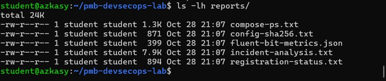

Skrip menghasilkan pesan [PASS] Evidence dibuat di direktori reports/. File .env tidak disertakan.


Direktori reports/ berisi lima berkas berikut:
1. compose-ps.txt
2. config-sha256.txt
3. fluent-bit-metrics.json
4. incident-analysis.txt
5. registration-status.txt
Berkas tersebut digunakan untuk mendokumentasikan status container, hash konfigurasi, metrik Fluent Bit, hasil analisis insiden, dan status pendaftaran. File .env tidak disertakan dalam kumpulan bukti.

## ANALISIS DAN PEMBAHASAN
Berdasarkan hasil pengujian, penerapan centralized logging pada sistem PMB membantu mengumpulkan catatan aktivitas dari beberapa layanan ke satu database log. Penggunaan request ID memudahkan penelusuran aktivitas yang berkaitan dengan transaksi tertentu sehingga urutan kejadian dapat diketahui tanpa harus memeriksa setiap layanan secara terpisah.
Pada skenario normal, pendaftaran berhasil mencapai status VERIFIED. Sebaliknya, pada skenario insiden, sistem menghasilkan status FAILED dengan kode VERIFY-TIMEOUT setelah tiga percobaan. Perbedaan tersebut menunjukkan bahwa log dan data transaksi dapat digunakan untuk membedakan keberhasilan proses dari kegagalan yang direncanakan dalam pengujian.
Pengujian penghentian database log menunjukkan bahwa Fluent Bit mengalami kegagalan pengiriman dan menjadwalkan retry ketika host log-db tidak dapat dijangkau. Setelah database diaktifkan kembali dan berstatus healthy, jumlah record log meningkat serta validasi akhir menunjukkan hasil PASS. Hal ini mendukung bahwa pengiriman dan penyimpanan log kembali berlangsung setelah pemulihan.
Pemeriksaan pola secret juga tidak menemukan kecocokan pada log yang diperiksa. Meskipun demikian, pemeriksaan tersebut hanya mencakup pola yang ditentukan dalam query sehingga tetap perlu dilengkapi dengan aturan sanitasi dan pemeriksaan lain jika digunakan pada lingkungan produksi.
Secara keseluruhan, hasil praktikum memperlihatkan manfaat centralized logging untuk pemantauan layanan, penelusuran insiden, pemeriksaan keamanan dasar, serta pengamatan pemulihan pengiriman log. Pengujian ini belum mengukur secara menyeluruh kehilangan atau duplikasi log selama gangguan.

## KESIMPULAN
Berdasarkan praktikum DevSecOps Bab 6, dapat disimpulkan bahwa centralized logging memungkinkan log dari beberapa layanan aplikasi PMB dikumpulkan dan disimpan secara terpusat menggunakan Fluent Bit dan database log. Pendekatan ini membantu proses pemantauan dan investigasi melalui penelusuran request ID, urutan event, severity, dan kode kesalahan.
Pengujian menunjukkan bahwa skenario normal berhasil menghasilkan status VERIFIED, sedangkan skenario insiden menghasilkan status FAILED dengan kode VERIFY-TIMEOUT. Saat database log dihentikan, Fluent Bit mencatat kegagalan pengiriman dan melakukan retry. Setelah database log kembali aktif, jumlah record bertambah dan validasi akhir menunjukkan bahwa layanan siap serta log tersimpan.
Pemeriksaan pola secret tidak menemukan kecocokan berdasarkan pola yang diuji, dan bukti praktikum berhasil dikumpulkan tanpa menyertakan file .env. Dengan demikian, praktikum memberikan pemahaman mengenai pengelolaan log terpusat, analisis insiden, mekanisme retry, dan validasi layanan. Pengujian tambahan tetap diperlukan untuk memastikan tingkat kelengkapan log serta mendeteksi kemungkinan kehilangan atau duplikasi selama gangguan.


